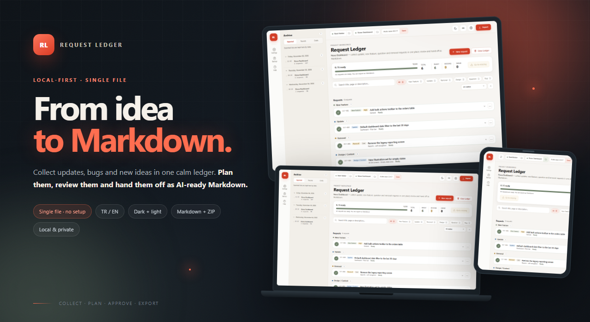
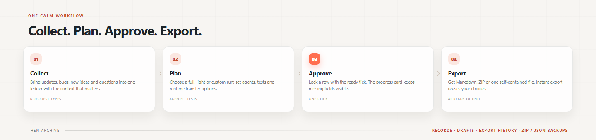
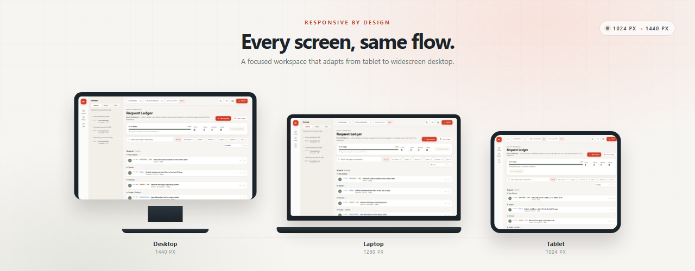
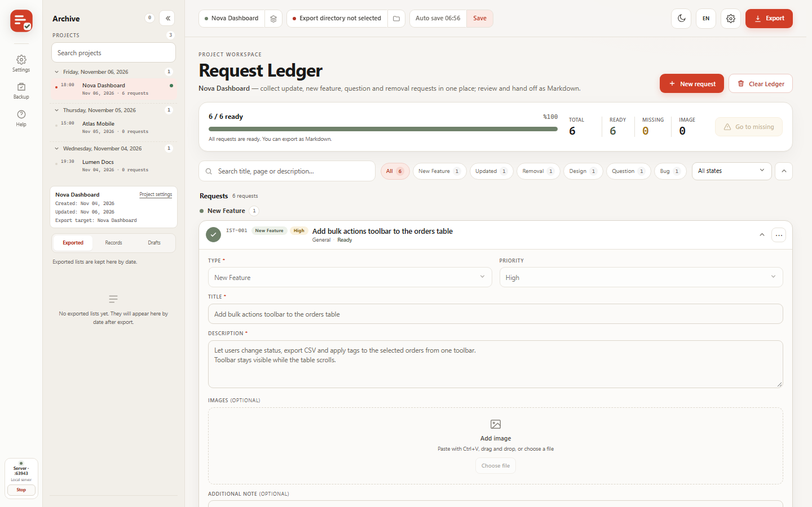
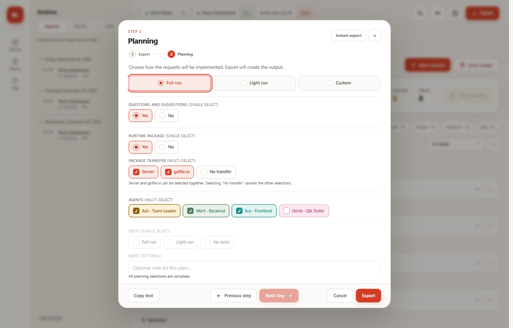
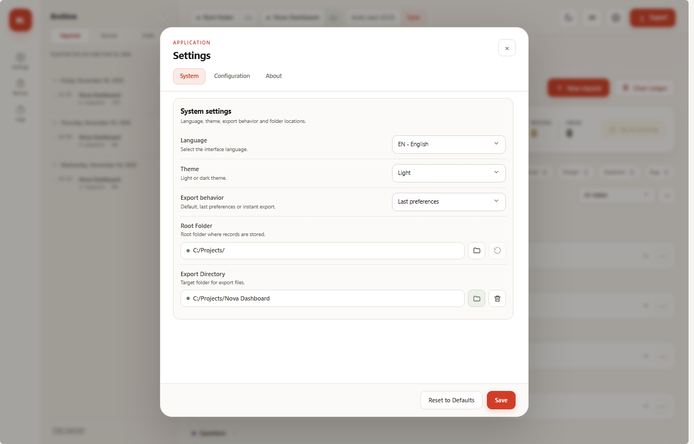
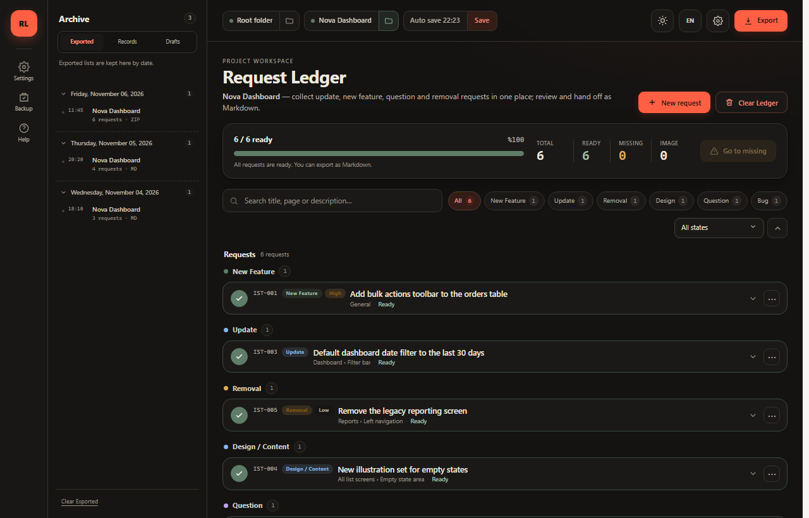
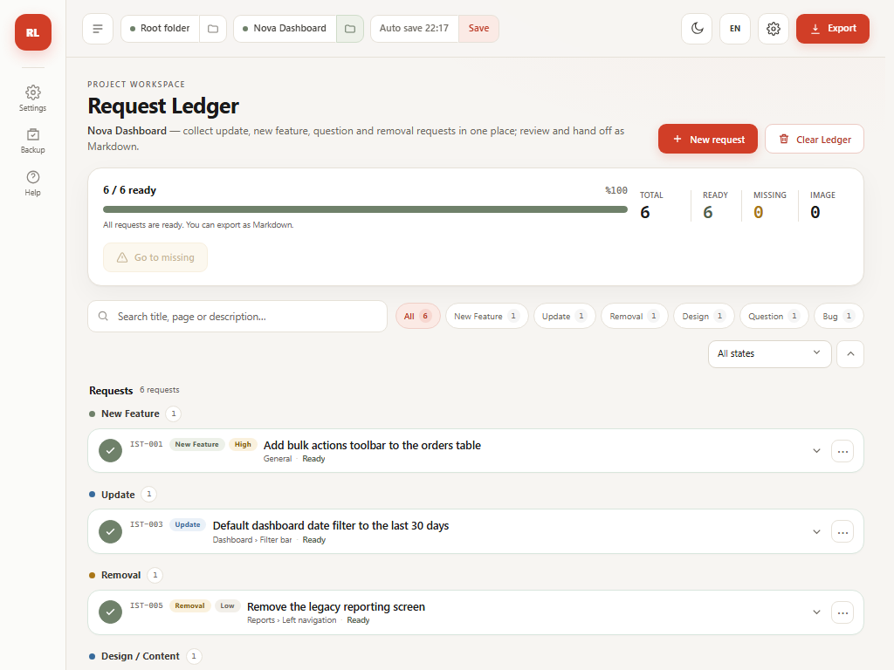

<p align="center">
  
</p>

<h1 align="center">Request Ledger</h1>

<p align="center">
  <b>From idea to Markdown, in one calm flow.</b><br>
  A local-first request management desk that runs in your browser.
</p>

<p align="center">
  <a href="index.html"></a>
  <a href="https://taneruner.github.io/request-ledger/"></a>
  
  
  
</p>

<p align="center">
  
</p>

<p align="center">
  <a href="#-what-is-request-ledger">What is it?</a> ·
  <a href="#-quick-start">Quick start</a> ·
  <a href="#-features">Features</a> ·
  <a href="#-who-is-it-for">Who is it for?</a> ·
  <a href="#-responsive-layout">Responsive</a> ·
  <a href="#-screens">Screens</a> ·
  <a href="#-technical-architecture">Architecture</a>
</p>

---

## 🧭 What is Request Ledger?

**Request Ledger** is a single-file web app for collecting product and project requests in one place, planning them, approving them, and turning them into **AI-ready Markdown**.

No server. No installation. No account. Your data stays in your browser.

> Scattered notes, messages and screenshots → one organized ledger → a clear plan → a handoff-ready Markdown file.

### What it solves

- Product ideas getting lost across chats, notes and screenshots.
- The same request being described differently by different people.
- Developers receiving incomplete, ambiguous or context-free tasks.
- Items marked “ready” that are not actually ready.
- The same list being saved as multiple confusing records.

---

## ⚡ Quick start

All you need is a modern browser.

```text
index.html
```

Double-click the file or drag it into your browser. That is it.

You can also serve it locally:

```bash
python -m http.server 8080
```

Then open `http://localhost:8080/index.html`.

> **Recommended:** Chrome, Edge or another current Chromium-based browser for image attachments, local records and backup features.

---

## ✨ Features

| | Feature | What it does |
|---|---|---|
| 🧩 | **6 request types** | Dedicated fields for new features, updates, removals, design, questions and bugs. |
| 🖼️ | **Images and attachments** | Paste screenshots with `Ctrl+V`; attach `.html`, `.css`, `.js`, PDF and other example files. |
| ✅ | **Ready approval and lock** | A request locks when marked ready; editing opens again only after the approval is revoked. |
| 📊 | **Live progress** | Ready / missing counts, percentage and missing-field hints in one card. |
| 🤖 | **Planning and agents** | Full run, light run or custom plan; tests, runtime and optional agent selection. |
| 📝 | **Markdown + ZIP** | Single `.md`, ZIP + `.md`, or base64-embedded output. Attachments travel in the ZIP. |
| 🚀 | **Instant export** | Save the current choices; later exports can run with the same selections without reopening the modal. |
| 🗂️ | **Records and ledger identity** | Records, drafts and exports with `ledgerId` duplicate protection. |
| 💾 | **Backup** | ZIP or JSON backup including settings, agents and history. |
| 🌗 | **Theme + language** | Dark/light theme, TR/EN interface and bilingual Markdown system output. |
| 🔒 | **Local and private** | No server, no telemetry; data is stored in `localStorage` + `IndexedDB`. |

---

## 🔄 How it works

<p align="center">
  
</p>

1. **Collect** — Add each request as its own row; enrich it with screenshots and files.
2. **Plan** — Choose a full, light or custom run; define agents and the test approach.
3. **Approve** — When required fields are complete, click the row’s checkmark. The row locks.
4. **Export** — Get a Markdown/ZIP output or use **Instant export** to save the current preferences.
5. **Archive** — Keep records, drafts and exports; take a ZIP/JSON backup regularly.

---

## 👥 Who is it for?

| User | Typical use |
|---|---|
| **Product managers** | Collect customer feedback, roadmap ideas and bug reports in one ledger. |
| **Indie developers** | Turn personal “fix this / add that” notes into a structured delivery list. |
| **Software teams** | Create a shared request language across product, design, engineering and QA. |
| **QA engineers** | Capture bug reproductions, screenshots and expected behavior without missing context. |
| **AI-assisted developers** | Hand Claude, Codex, Gemini or similar agents a clean Markdown brief. |
| **Freelancers and agencies** | Separate client requests per project and maintain a clear delivery/archive flow. |
| **Students and makers** | Break project ideas into small, plannable requests. |

---

## 📐 Responsive layout

<p align="center">
  
</p>

The interface is not just a shrunken desktop page; the layout adapts at each breakpoint.

| Device | Approx. width | Behavior |
|---|---:|---|
| Tablet | 1024 px | Content expands; the archive panel opens only when needed. |
| Laptop | 1280 px | Left rail + main workspace + optional archive panel. |
| Desktop | 1440 px+ | Full layout, wide request rows and side panel. |

- Content reflows instead of overflowing.
- Forms, modals and export steps remain usable across breakpoints.
- Long text wraps or truncates cleanly.
- Dark and light themes are preserved throughout.

---

## 🖥️ Screens

### Main workspace

<p align="center">
  
</p>

### Export and planning

<p align="center">
  
</p>

### System settings

<p align="center">
  
</p>

### Dark theme

<p align="center">
  
</p>

### Tablet

<p align="center">
  
</p>

> Screenshots use a sample project called **Nova Dashboard** with demo data.

---

## 📝 Markdown output

Exports include a title, date, summary table, planning, agents, test decision, runtime package and a dedicated section for every request.

```md
# Nova Dashboard — Development Requests

> Friday, November 06, 2026 · 6 requests · 3 images · 1 file

## Summary

| # | Type | Title | Priority |
|---|---|---|---|
| IST-001 | New Feature | Add bulk actions toolbar to the orders table | High |
| IST-002 | Bug | Long user names overflow in the header menu | High |

## Planning

**Run type:** Full run

**Agents to Invoke:**

| Role | MD File Path |
|---|---|
| Team Leader | agents/team-leader.md |
| Frontend | agents/frontend.md |
| QA Tester | agents/qa.md |

## IST-001 — Add bulk actions toolbar to the orders table

- **Type:** New Feature
- **Priority:** High
- **Status:** Ready

### Request

Let users change status, export CSV and apply tags to selected orders
from a single toolbar.
```

- **ZIP + .md**: Markdown in a separate file; images and attachments inside the ZIP.
- **Single .md**: Images embedded as base64; attachments require ZIP.
- **TR/EN**: System labels follow the selected interface language.
- **User content is never translated**: titles, descriptions and notes stay exactly as written.

---

## 🧱 Technical architecture

| Layer | Technology | Notes |
|---|---|---|
| UI | HTML + CSS + vanilla JavaScript | No framework, no build step. |
| Distribution | One `.html` file | Runs from `file://` or any static host. |
| Text state | `localStorage` | Language, theme, agents and last export preferences. |
| Media + archive | `IndexedDB` | Images, attachments, records, drafts and export history. |
| File writing | File System Access API | Direct writes to a selected folder where supported. |
| Backup | JSON + ZIP | Settings, agents, records and ledger identity included. |
| Translation | TR/EN dictionary + DOM observer | Static and dynamic UI text, plus Markdown output. |

---

## 🔐 Privacy and data

- **No server.** No request, image or file is sent to a remote server.
- **No account.** No sign-up, login or email verification.
- **No telemetry.** Usage data is not collected.
- **Local storage.** Data stays in the browser’s `localStorage` and `IndexedDB`.
- **User-controlled exports.** Files are written only to the folder you select.
- **Backup responsibility.** Clearing browser data deletes local records; take regular ZIP/JSON backups.

---

## ⌨️ Small details that matter

| Shortcut / behavior | Result |
|---|---|
| `Ctrl+V` | Adds a screenshot to the open request row. |
| `Esc` | Closes the open menu or top modal. |
| `Enter` | Triggers save in some modals. |
| Drag and drop | Drops an image or file into the relevant area. |
| Ready tick | Locks the row; editing resumes when approval is revoked. |
| Duplicate ledger | Shows “This list is already saved” using `ledgerId`. |
| Rename record | Changes the display name only; the exported `.md` filename is unaffected. |

---

## ⚠️ Limitations

- The File System Access API is not available in every browser; without it, exports go to the downloads folder.
- Browsers may block writing to system locations such as `C:\` or the desktop root. Choose a writable subfolder.
- Data is stored in the browser profile; there is no automatic cross-device sync.
- Very large images or files can consume browser storage; regular backups and cleanup are recommended.
- User-written content in Markdown output is not translated.

---

## 🤝 Contributing

This project is currently developed for personal use and product delivery workflows.

- Open an **Issue** for a bug report or suggestion.
- For code contributions, share your intent in a short **Discussion** or Issue first.
- When changing Markdown output, include a sample of the new output.

---

## 📬 Contact

- **Developer:** Taner ÜNER (He has AI agents 😂)
- **GitHub:** [github.com/TanerUNER](https://github.com/TanerUNER)
- **Email:** [mail.taneruner@gmail.com](mailto:mail.taneruner@gmail.com)
- **Support:** [Buy Me a Coffee](https://www.buymeacoffee.com/tnruner)

---

## 📄 License

This project is released under the **MIT License**.

You are free to use, copy, modify, merge, publish, distribute, sublicense and sell copies of the software, provided the copyright notice and permission notice are included. The software is provided “as is”, without warranty of any kind.

See [`LICENSE`](LICENSE) for the full text.

<p align="center">
  <sub>Request Ledger · From idea to Markdown, in one calm flow.</sub><br>
  <sub>Runs locally. Your data stays yours.</sub>
</p>
