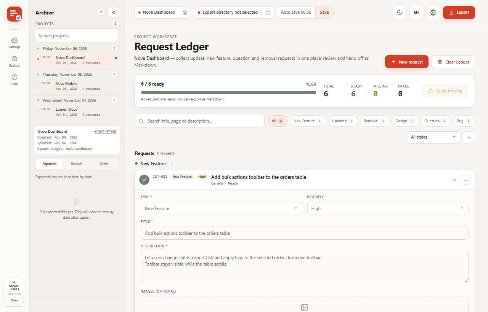
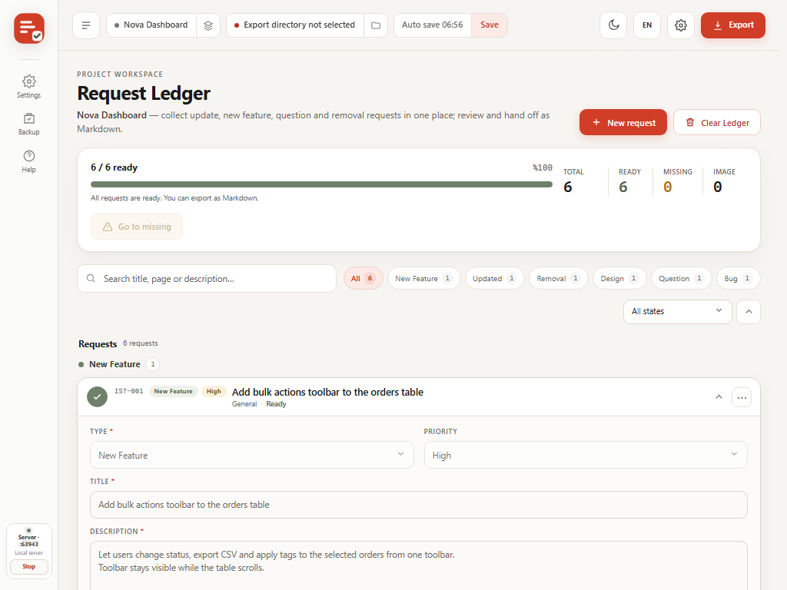
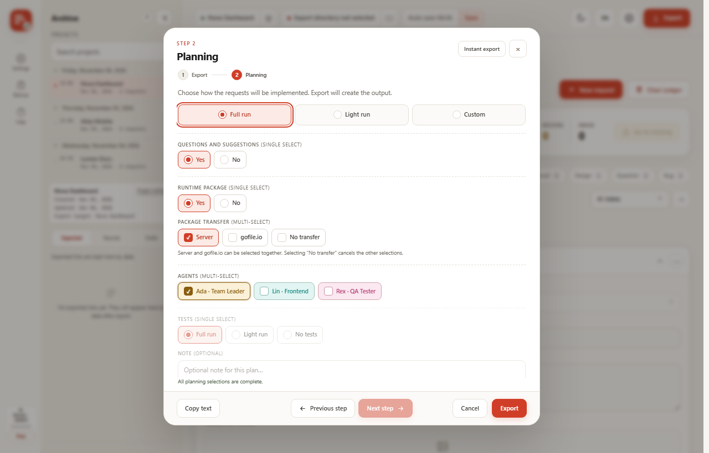
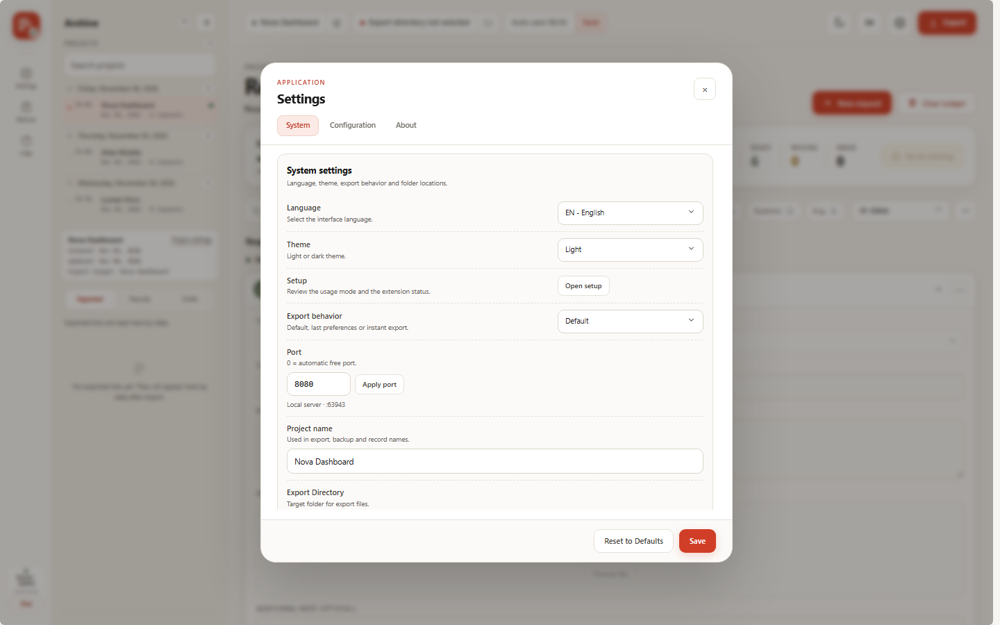
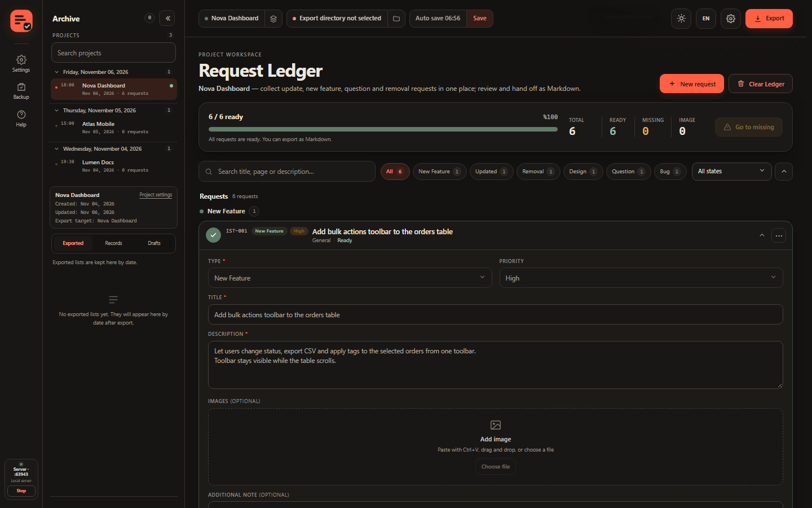
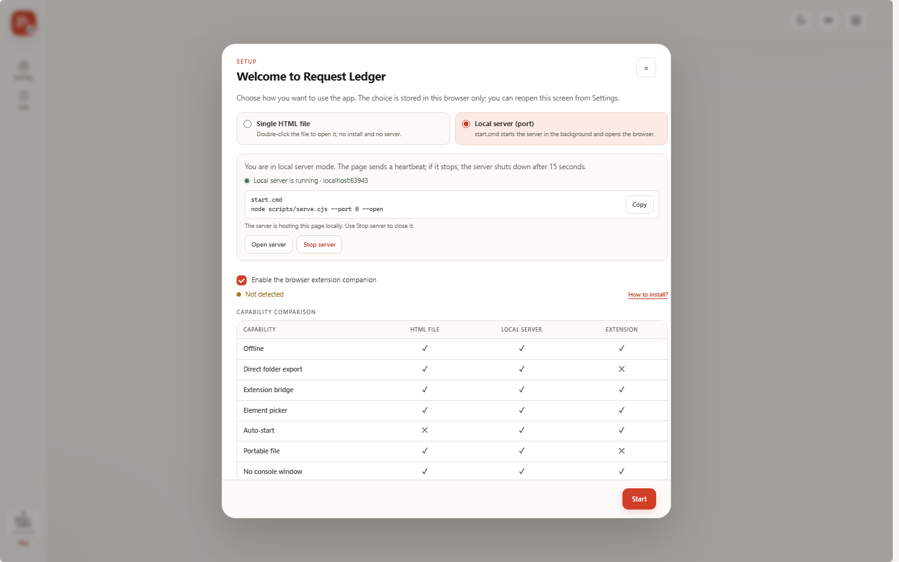

<p align="center">
  
</p>

<p align="center">
  <b>From idea to Markdown, in one calm flow.</b><br>
  A local-first request desk for product teams, freelancers and AI-assisted developers.
</p>

<p align="center">
  <a href="README.tr.md">Türkçe</a> · English
</p>

<p align="center">
  
  
  
  
  
</p>

<p align="center">
  <a href="#what-it-is">What it is</a> ·
  <a href="#how-it-works">How it works</a> ·
  <a href="#workspace-and-projects">Projects</a> ·
  <a href="#two-run-modes">Run modes</a> ·
  <a href="#chrome-companion">Extension</a> ·
  <a href="#backups">Backups</a> ·
  <a href="#privacy">Privacy</a> ·
  <a href="#limitations">Limitations</a>
</p>

<p align="center">
  
</p>

---

## What it is

Request Ledger is a **local-first request desk** that runs in your browser. It collects product
requests, bugs, questions and design notes, checks whether they are complete, plans the delivery,
requires an explicit approval, and exports **AI-ready Markdown**.

No account. No telemetry. No remote code. Your data stays in your browser profile. A local server is
optional and only adds the server mode and convenience around the Chrome companion.

> Scattered notes, chat messages and screenshots → one organised ledger → one clear plan → one
> handoff-ready Markdown file.

### The problem it solves

| Without Request Ledger | With Request Ledger |
|---|---|
| Requests live in chat, e-mail, notes and screenshots. | One ledger with one row per request. |
| Nobody knows which request is complete. | Live ready/missing counts and a missing-field list. |
| The handoff to a developer or an AI agent is improvised. | A consistent Markdown plan with agents, tests and runtime options. |
| Old versions of a request get mixed together. | Records, drafts and export history per project. |
| Moving to another browser loses the context. | A versioned ZIP backup with media. |

### Who it is for

- Product managers and founders who collect requests from many people.
- Indie developers and small teams who want a structured delivery list.
- QA engineers who need reproducible bug reports with page, location and console context.
- AI-assisted developers who hand work to coding agents and need a clean Markdown brief.
- Freelancers who want a portable, private workspace without another SaaS account.

<p align="center">
  
</p>

## How it works

1. **Collect** — add each request as its own row. Choose one of six types; each type shows the fields
   that matter. Attach screenshots with `Ctrl+V`, drag and drop, or the file picker.
2. **Plan** — choose a full, light or custom run, select agents and tests, and decide how the runtime
   package travels.
3. **Approve** — when the required fields are complete, click the row's checkmark. The row locks;
   editing resumes only after the approval is revoked.
4. **Export** — get a ZIP with Markdown and media, a single `.md` with embedded images, or a plain
   Markdown file. Save your choices once and later exports reuse them with **Instant export**.
5. **Archive** — keep records, drafts and export history, then take a backup regularly.

## Workspace and projects

The workspace is a registry of projects. Every project keeps its own:

- request ledger and export target;
- images and file attachments;
- Records, Drafts and export history;
- archive state and project name.

Projects are owned by the app; the Chrome companion mirrors the active project and has no project
management UI of its own. Switching projects is guarded by the unsaved-changes confirmation. Project
ids are never merged, so two projects with similar names stay separate. Deleting a project removes
its `projects/<slug>/` folder from disk; you can keep a ZIP copy under `deleted-projects/` and
restore it later. A port change is silent: the current browser data is flushed to disk first and the
page simply moves to the new server.

## Two run modes

| | Single HTML file | Local server |
|---|---|---|
| **How to start** | Open `request-ledger.html` or `index.html` directly, or host it statically. | Run `start.cmd` on Windows, or `node scripts/serve.cjs 8080` anywhere. |
| **Best at** | A portable file you can copy, archive or open offline. | A stable local URL, a visible status dot with the port and a remembered port. |
| **Extension bridge** | Works when the extension is installed and allowed to access file URLs. | Works on `localhost` or `127.0.0.1` while the app tab is open. |
| **Local server** | Not available; the file cannot start one. | Started by the launcher; it stops about 5 s after the last app tab closes, or after 5 minutes without a live page as a fallback. |
| **Requires** | A modern browser. | Node.js 18 or newer on `PATH`. |

`start.cmd` starts the server without a console window, opens the browser and writes
`.rl-server.lock` with the process id and port. It remembers the last port in `.rl-port` (`0` means
automatic); if that port is busy it starts on a free port and tells you. `stop.cmd` reads the lock and
shuts the server down.

### Server lifecycle and runtime data

Reloading, navigating or a hidden app tab keeps the server alive. Closing the last app tab sends a
close signal and the server stops after a **5-second grace**, releasing the port and removing the lock
file; another open tab or a reload in that window cancels the shutdown. If no close signal arrives (for
example a crashed tab), the launcher’s 300-second idle stop is the fallback. `stop.cmd` still shuts it
down immediately. Stopping is not a page action: a browser cannot spawn a process, so a fully stopped
server is started again with **`start.cmd`**.

Runtime user data lives next to `scripts/serve.cjs` and is never committed to git:

| Path | Contents |
|---|---|
| `projects/<slug>/` | Live project data: `project.json`, `ledger.json`, `archive.json`, `media.json`, `media/` and `exports/`. |
| `backups/` | Full backup ZIPs written by the app. Kept by a full reset. |
| `deleted-projects/` | Per-project ZIPs created when a project is deleted with "keep a backup". |
| `rl-config.json` | Server-side UI config (language, theme, last port). |

In server mode, each app project owns a folder under `projects/<project-slug>/` in the app directory.
**Save** writes the current ledger snapshot there (`ledger.json`); **Export** writes to the chosen
target folder when one is set, otherwise to the project folder’s `exports/` directory. The archive
project list/records read this folder metadata. In `file://` mode there is no server folder write:
Save/Export show a clear “server mode required for folder saves” message and fall back to browser
downloads.

While the server is alive, Settings offers **Restart server** and **Port**. Both spawn a replacement
process; a port change is applied only after the new instance answers `/__rl/status` with its own pid
and port, so the page never lands on a dead address. If the new instance does not come up, the old
server keeps running and a toast explains that the port could not be changed.

## Chrome companion

The `extension/` folder is an unpacked **Manifest V3** extension for Chrome and Edge 114+. It is a
**companion**: it appears only while the Request Ledger app is open. It adds a 44 px opener at the
bottom-right of pages and a 360 px flyout; it does not reflow the page.

| Capability | What it does |
|---|---|
| **Live companion** | The app is required. While it is open, requests, media and the active project sync both ways. If the app is not running, **no extension UI is shown at all** — no rail, launcher, iframe or lock card. It returns automatically when the app starts. On a browser restart it verifies the app before showing anything: a previously connected state never survives a restart, and with the app closed nothing appears on any page. |
| **App-owned projects** | Projects are created, renamed, switched and deleted only in the app. The extension always follows the app’s active project; it has no project list, picker or creation UI. |
| **Media sync** | Paste, file upload, screenshot and element+screenshot images cross the bridge. Each item is capped at 8 MB; larger items travel only with a backup ZIP. A thumbnail whose blob is still in transit shows a neutral “Loading image…” state instead of “Image not found”. |
| **Element picker** | Pick an element on the current page or on a tab chosen from the app. Repeated picks append selectors with `" | "` on both surfaces (deduped, 200-character cap). |
| **Screenshot** | Choose a tab, crop the region you need, and attach the image to the active request. The page path fills automatically. |
| **Request desk in the dock** | Create, edit, search, reorder and approve requests without leaving the page. Ready/locked requests still allow image preview, never editing. |
| **Per-tab pin and theme** | Pin state and the light/dark panel theme are stored per browser tab in session storage, so changing them on one page never affects another. A new tab starts from the defaults; closing it clears its keys. |
| **Toolbar popup** | Clicking the browser action opens a small About card with the name, version, repository, support link and MIT license; it states that the app must be open. The in-page dock is unchanged. |
| **Backup and transfer** | Download a ZIP backup, restore one, or move data between the extension and the web app. |

The extension cannot enable or disable itself from `chrome://extensions`. If you disable it there, it
cannot come back by itself; re-enable it manually. When the app is closed, the extension is simply
invisible, not disabled. Presence is verified, not assumed: every presence write carries a timestamp,
a value older than ~12 s is ignored, and the dock mounts only after a live check of the app or its
server. A stale `true` from a previous browser session therefore never mounts the UI at startup.

Install it from `chrome://extensions` → **Developer mode** → **Load unpacked** → select `extension/`
(or the unzipped `request-ledger-extension.zip`). The pinned extension id is
`hapajcbgcfllhkiohhkechekajencdod`; changing the `key` in `manifest.json` creates a new origin with
empty storage.

## Backups

Both products use the same backup family. The web app writes **v4**, the extension writes **v3** and
reads **v4**. Only the full ZIP backup remains: it is always a compressed archive and includes media
when present.

| Format | Contains | Use it when |
|---|---|---|
| **ZIP (v4)** | Every project, requests, Records, Drafts, agents, images and attachments. | You want a complete, movable archive. |

In server mode a full backup is also written to `backups/` on disk; the backup screen lists the stored
backups (newest first) with a restore action and also lists `deleted-projects/` archives. **Clear
project data** is a full reset: it removes every live project and every deleted-project archive but
keeps `backups/`, and it offers to take a backup first.

Restore validates the bundle before touching your data and never deletes media up front. A v4 backup
restores every project; a v3 backup restores into one project. Backups are plaintext files — treat
them as sensitive documents.

## Screenshots

The interface is built for desktop, laptop and tablet widths. Mobile is intentionally out of scope
for this release.

| Desktop · 1440 px | Laptop · 1280 px | Tablet · 1024 px |
|---|---|---|
|  |  |  |

<p align="center">
  
</p>

| Planning | Settings | Dark theme | First-run setup |
|---|---|---|---|
|  |  |  |  |

## Markdown output

```md
# Nova Dashboard — Development Requests

> Sunday, November 08, 2026 · 6 requests · 4 images · 1 file

## Summary

| # | Type | Title | Priority |
|---|---|---|---|
| IST-001 | New Feature | Add bulk actions toolbar to the orders table | High |

## Planning

**Run type:** Full run

## IST-001 — Add bulk actions toolbar to the orders table

- **Type:** New Feature
- **Priority:** High
- **Status:** Ready

### Request

Let users change status, export CSV and apply tags to selected orders.
```

- **ZIP + `.md`** — Markdown in a separate file; media in `gorseller/` and `dosyalar/`.
- **Single `.md`** — images embedded as base64; attachments require ZIP.
- **TR / EN** — system labels follow the interface language. User content is never translated.

## Privacy

- **No account, no telemetry, no analytics.** Nothing is uploaded.
- **No remote code.** The app loads no external scripts, styles or fonts. The support link is a plain
  link and loads nothing.
- **Local server, loopback only.** `scripts/serve.cjs` binds to `127.0.0.1` and serves files from the
  project folder.
- **Extension stays local.** It makes no outbound requests; captures and downloads stay on your
  machine.
- **User-controlled exports.** Files are written only where you choose; browsers without File System
  Access fall back to Downloads.
- **Clearing browser data deletes the ledger.** Keep ZIP backups.

The bridge accepts `file://`, `localhost` and `127.0.0.1` only. A local process or a page on one of
those origins could still talk to it, so run only trusted local servers while the app is open. The
extension page is an iframe on an untrusted page; treat screenshots on untrusted pages as public.

## Requirements

| Requirement | Details |
|---|---|
| Browser | Any current Chromium, Firefox or Safari for the web app. Chrome or Edge **114+** for the extension. |
| Node.js | **18 or newer**, only for the local server. The single HTML file needs no runtime. |
| Windows launchers | `start.cmd` / `stop.cmd` are Windows batch files. `scripts/serve.cjs` also runs on macOS and Linux. |
| Folder export | File System Access API (Chromium). Other browsers download files instead. |
| File URLs | `file://` was measured in Chrome 157. Other browsers may isolate or restrict storage. |

## Limitations

- **Mobile is out of scope.** The layout targets desktop (1440 px), laptop (1280 px) and tablet
  (1024 px).
- The single HTML file cannot start the local server. The extension bridge can still connect when the
  extension is allowed to access file URLs, but there are no server project-folder writes.
- A web page cannot spawn a process. Restart and port changes work only while the server is alive;
  after a hard stop, run `start.cmd` and reload the page — the app does not silently reconnect.
- The companion re-checks presence after a browser restart. A connection from the previous session
  never makes it appear, and no UI mounts until the app (or its server) answers.
- Live media sync is capped at **8 MB per item**. Larger images/attachments and all media in a
  portable archive still travel with a backup ZIP.
- The extension is a companion: with no app running, it shows no UI on any page. It cannot re-enable
  itself after being disabled in `chrome://extensions`.
- Projects are app-owned; the extension cannot create, list or switch projects on its own.
- Backups are plaintext. Theme and export history are not part of backups.
- Restore expects the app's stored ZIP entries; a re-zipped archive may be rejected.
- Very large images or files consume browser storage. Take backups and clean up old media.
- Firefox and Safari can run the web app, but the Manifest V3 extension is Chromium-only.
- User-written content is never translated.

## Project layout and build

The tracked application lives in `_source/`.

```text
_source/
├── index.html                  single-file web app (generated)
├── extension/                  unpacked Manifest V3 extension
├── src/                        web, panel and core sources
├── scripts/                    build, server and README asset tools
├── tests/                      golden, parity and browser e2e
├── assets/                     logo.svg, logo-wordmark.svg
├── README-assets/              reproducible README templates and images
└── dist/                       release packages (generated)
    └── request-ledger.html     single-file build for offline use
```

`index.html` and `extension/panel/panel.js` are generated from `src/`. Edit the fragments, then run:

```powershell
cd _source
node scripts/build.cjs                 # dist/, request-ledger.html, extension ZIPs
node scripts/build.cjs --check         # generated files and hashes are current
node scripts/check-inline.cjs          # inline script syntax
$env:TZ='UTC'; node scripts/generate-golden.cjs --check
node tests/parity/model.parity.mjs
node tests/parity/drift.parity.mjs
node scripts/render-readme-assets.cjs  # real screenshots + HTML marketing images
```

Browser end-to-end tests need a local server and Chrome/Edge:

```powershell
node scripts/serve.cjs 8080
node tests/e2e/extension.e2e.cjs
node tests/e2e/bridge.e2e.cjs
node tests/e2e/picker.e2e.cjs
node tests/e2e/capture-tools.e2e.cjs
node tests/e2e/file-bridge.e2e.cjs
```

## Contributing

- Open an issue for a bug or a suggestion.
- For code changes, describe the intent first.
- When changing Markdown output, include a sample and update the golden files intentionally.

## Contact

- **Developer:** Taner ÜNER
- **GitHub:** [github.com/TanerUNER](https://github.com/TanerUNER)
- **Email:** [mail.taneruner@gmail.com](mailto:mail.taneruner@gmail.com)
- **Support:** [Buy Me a Coffee](https://www.buymeacoffee.com/tnruner)

## License

MIT. See [`LICENSE`](LICENSE).

<p align="center">
  <br>
  <sub>Request Ledger · From idea to Markdown, in one calm flow.</sub><br>
  <sub>Runs locally. Your data stays yours.</sub>
</p>
