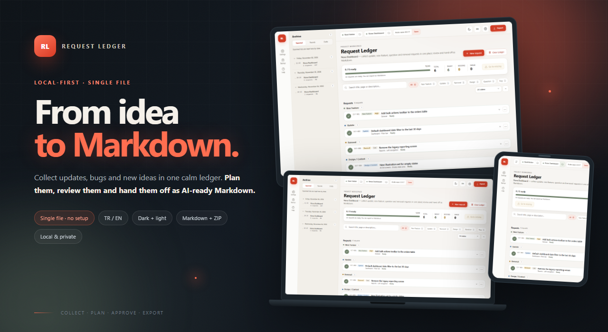
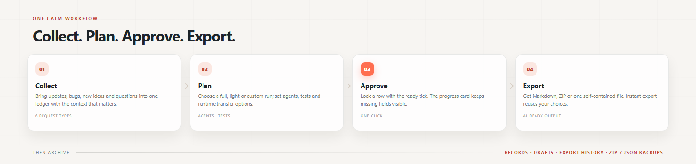
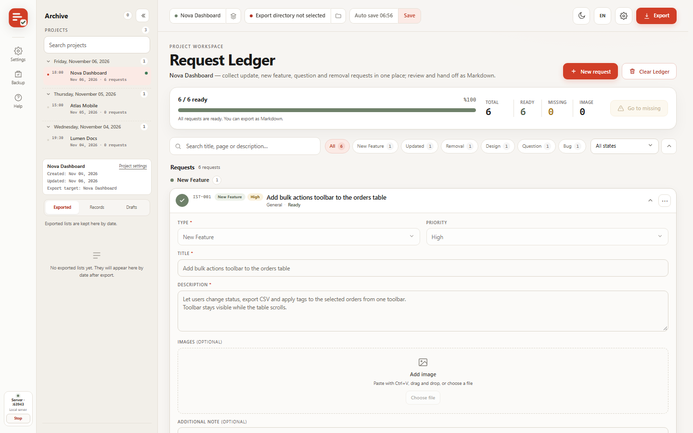
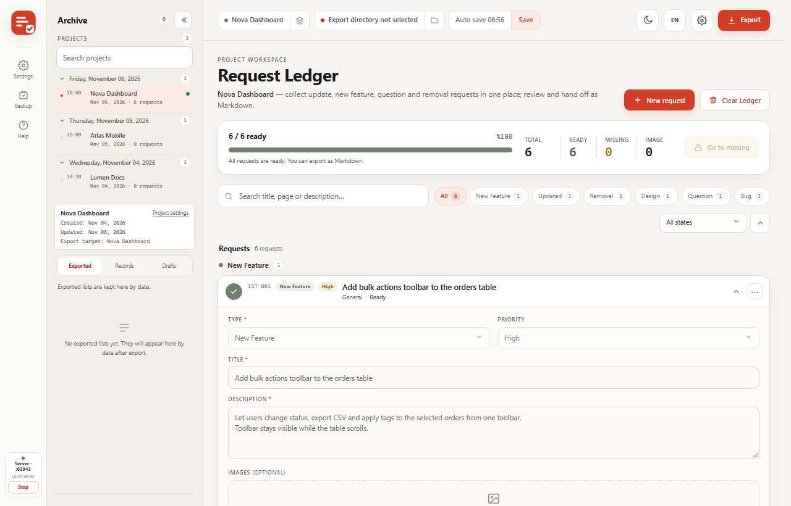
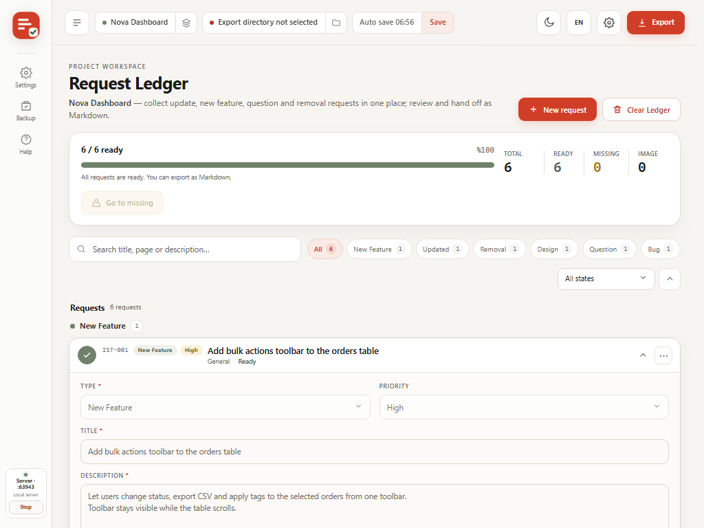
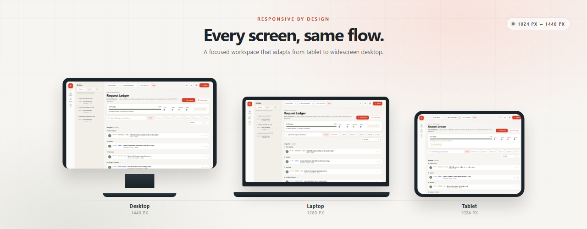
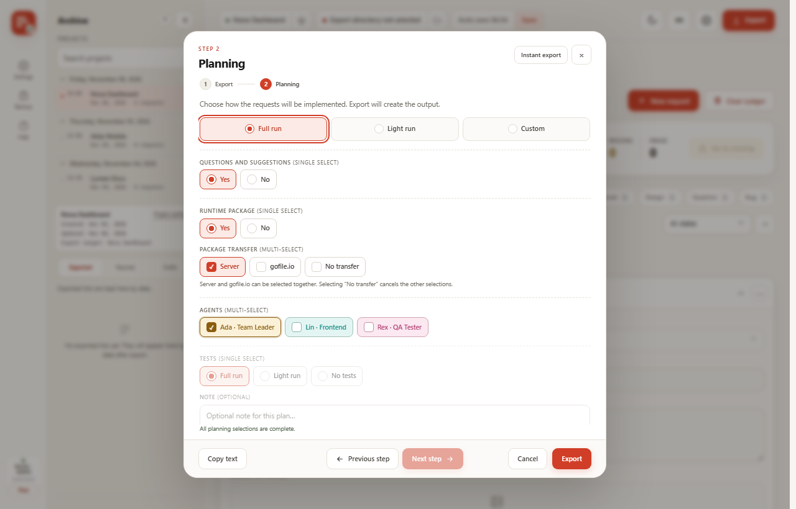
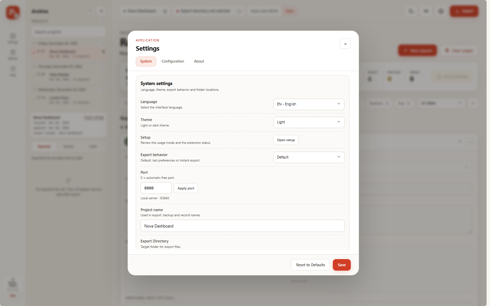
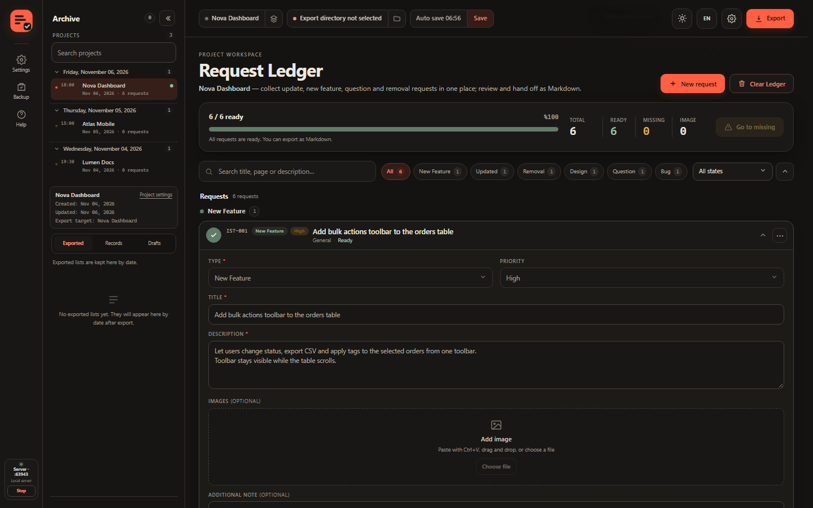
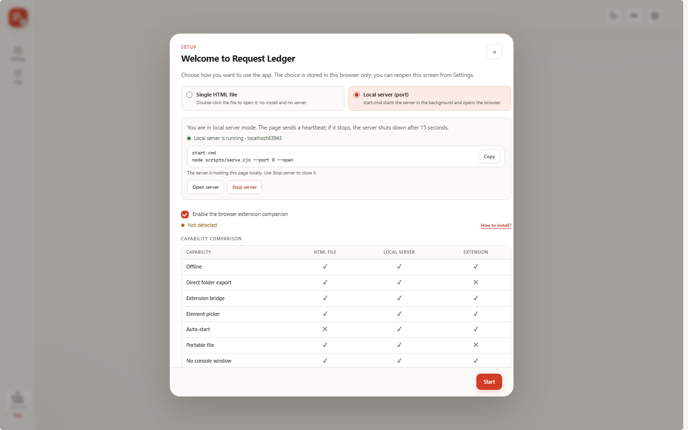

<p align="center">
  
</p>

<p align="center">
  <b>Fikirden Markdown’a, tek ve sakin bir akış.</b><br>
  Ürün ekipleri, serbest çalışanlar ve yapay zekâ destekli geliştiriciler için yerel öncelikli istek masası.
</p>

<p align="center">
  <a href="README.md">English</a> · Türkçe
</p>

<p align="center">
  
  
  
  
  
</p>

<p align="center">
  <a href="#nedir">Nedir?</a> ·
  <a href="#nasil-calisir">Nasıl çalışır?</a> ·
  <a href="#calisma-alani-ve-projeler">Projeler</a> ·
  <a href="#iki-calistirma-modu">Çalıştırma modları</a> ·
  <a href="#chrome-yardimcisi">Uzantı</a> ·
  <a href="#yedekler">Yedekler</a> ·
  <a href="#gizlilik">Gizlilik</a> ·
  <a href="#sinirlamalar">Sınırlamalar</a>
</p>

<p align="center">
  
</p>

---

<a id="nedir"></a>
## Nedir?

Request Ledger, tarayıcıda çalışan **yerel öncelikli bir istek masasıdır**. Ürün isteklerini, hataları,
soruları ve tasarım notlarını tek yerde toplar; eksik olup olmadığını kontrol eder; teslimatı planlar;
açık bir onay ister ve **yapay zekâya hazır Markdown** olarak dışa aktarır.

Hesap yok. Telemetri yok. Uzak kod yok. Veriler tarayıcı profilinizde kalır. Yerel sunucu isteğe
bağlıdır; yalnızca sunucu modunu ve Chrome yardımcısı çevresindeki kolaylıkları ekler.

> Dağınık notlar, sohbet mesajları ve ekran görüntüleri → tek düzenli defter → net bir plan → teslimata
> hazır tek Markdown dosyası.

### Hangi sorunu çözer?

| Request Ledger olmadan | Request Ledger ile |
|---|---|
| İstekler sohbette, e-postada, notlarda ve ekran görüntülerinde dağılır. | Her istek için tek satır, tek defter. |
| Hangi isteğin tamamlandığı bilinmez. | Canlı hazır/eksik sayıları ve eksik alan listesi. |
| Geliştiriciye veya yapay zekâ ajanına teslim doğaçlama olur. | Ajan, test ve runtime seçenekleriyle tutarlı Markdown planı. |
| İsteğin eski sürümleri birbirine karışır. | Proje başına Kayıtlar, Taslaklar ve dışa aktarma geçmişi. |
| Başka tarayıcıya geçince bağlam kaybolur. | Medyayı taşıyan sürümlü ZIP yedeği veya metin JSON yedeği. |

### Kimler için?

- Birçok kişiden istek toplayan ürün yöneticileri ve kurucular.
- Düzenli bir teslimat listesi isteyen bağımsız geliştiriciler ve küçük ekipler.
- Sayfa, konum ve konsol bağlamıyla tekrarlanabilir hata kaydı isteyen QA mühendisleri.
- İşi kodlama ajanlarına devreden ve temiz bir Markdown brief’i isteyen yapay zekâ destekli geliştiriciler.
- Başka bir SaaS hesabı istemeyen, taşınabilir ve gizli bir çalışma alanı arayan serbest çalışanlar.

<p align="center">
  
</p>

<a id="nasil-calisir"></a>
## Nasıl çalışır?

1. **Topla** — her isteği kendi satırına ekle. Altı türden birini seç; her tür yalnızca ilgili alanları
   gösterir. Ekran görüntülerini `Ctrl+V` ile yapıştır, sürükle-bırak veya dosya seçiciyle ekle.
2. **Planla** — tam, hafif veya özel bir koşu seç; ajanları ve testleri belirle; runtime paketinin nasıl
   taşınacağına karar ver.
3. **Onayla** — zorunlu alanlar tamamlandığında satırdaki tiki tıkla. Satır kilitlenir; düzenleme ancak
   onay geri alındığında açılır.
4. **Dışa aktar** — Markdown ve medya içeren ZIP, görselleri gömülü tek `.md` veya düz Markdown al.
   Seçimleri bir kez kaydet; sonraki aktarımlar **Hemen aktar** ile aynı seçimleri kullanır.
5. **Arşivle** — Kayıtları, Taslakları ve dışa aktarma geçmişini tut; düzenli olarak yedek al.

<a id="calisma-alani-ve-projeler"></a>
## Çalışma alanı ve projeler

Çalışma alanı bir proje kayıt defteridir. Her proje kendi şunlarını ayrı tutar:

- istek defteri ve dışa aktarma hedefi;
- görseller ve dosya ekleri;
- Kayıtlar, Taslaklar ve dışa aktarma geçmişi;
- arşiv durumu ve proje adı.

Projeler uygulamaya aittir; Chrome yardımcısı yalnızca etkin projeyi yansıtır ve kendi proje yönetim
arayüzü yoktur. Proje değiştirirken kaydedilmemiş değişiklik onayı devreye girer. Proje kimlikleri
hiçbir zaman birleştirilmez; benzer adlı iki proje ayrı kalır. Port değişikliği yeni bir tarayıcı
kaynağı demektir: uygulama sizi uyarır, önce ZIP yedeği indirmeyi önerir ve yeni kaynakta geri yükleme
istemi gösterir.

<a id="iki-calistirma-modu"></a>
## İki çalıştırma modu

| | Tek HTML dosyası | Yerel sunucu |
|---|---|---|
| **Nasıl başlatılır** | `request-ledger.html` veya `index.html` dosyasını doğrudan açın ya da statik olarak yayınlayın. | Windows’ta `start.cmd`, her yerde `node scripts/serve.cjs 8080`. |
| **En iyi olduğu yer** | Kopyalanabilen, arşivlenebilen veya çevrimdışı açılan taşınabilir dosya. | Sabit yerel adres, görünür sunucu durumu, durdurma düğmesi ve hatırlanan port. |
| **Uzantı köprüsü** | Uzantı kuruluysa ve dosya URL’lerine erişim izni varsa çalışır. | Uygulama sekmesi açıkken `localhost` veya `127.0.0.1` üzerinde çalışır. |
| **Yerel sunucu** | Yok; dosya sunucu başlatamaz. | Başlatıcı açar; açıkça durdurulur, son uygulama sekmesi kapandıktan ~5 saniye sonra ya da canlı sayfa olmadan 5 dakika geçince (yedek davranış) kapanır. |
| **Gereksinim** | Güncel bir tarayıcı. | `PATH` üzerinde Node.js 18 veya daha yenisi. |

`start.cmd` sunucuyu konsol penceresi olmadan başlatır, tarayıcıyı açar ve süreç kimliği ile portu
`.rl-server.lock` dosyasına yazar. Son portu `.rl-port` içinde hatırlar (`0` otomatik demektir); port
doluysa boş bir portta başlar ve bunu size söyler. `stop.cmd` kilidi okur ve sunucuyu kapatır.

### Sunucu yaşam döngüsü ve proje klasörleri

Uygulamayı yenilemek, gezinmek veya sekmeyi arka planda tutmak sunucuyu yaşatır. Son uygulama sekmesi
kapanınca kapatma sinyali gider ve sunucu **5 saniyelik ek süreden** sonra durur; port serbest kalır ve
kilit dosyası silinir. Bu pencerede açılan başka bir sekme veya yenileme kapanmayı iptal eder. Kapatma
sinyali hiç ulaşmazsa (örneğin çökmüş bir sekme), başlatıcının 300 saniyelik boşta durma kuralı yedek
davranıştır. `stop.cmd` yine hemen kapatır.

Sunucu modunda her proje uygulama dizininde `projects/<proje-adı>/` klasörüne sahiptir. **Kaydet** geçerli
defter anlık görüntüsünü buraya (`ledger.json`) yazar; **Dışa Aktar** hedef klasör seçiliyse oraya,
seçili değilse proje klasöründeki `exports/` dizinine yazar. Arşiv proje listesi/kayıtları bu klasör
bilgisini okur. `file://` modunda sunucu klasörü yazımı yoktur: Kaydet/Dışa Aktar açık bir “klasör
kaydı için sunucu modu gerekli” mesajı gösterir ve tarayıcı indirmesine düşer.

<a id="chrome-yardimcisi"></a>
## Chrome yardımcısı

`extension/` klasörü Chrome ve Edge 114+ için paketlenmemiş bir **Manifest V3** uzantısıdır. Bir
**yardımcıdır**: yalnızca Request Ledger uygulaması açıkken görünür. Sayfaların sağ alt köşesine 44 px
bir açıcı ve 360 px bir panel ekler; sayfayı yeniden akıtmaz.

| Yetenek | Ne yapar? |
|---|---|
| **Canlı yardımcı** | Uygulama gerekir. Açıkken istekler, medya ve etkin proje iki yönde eşitlenir. Uygulama kapalıyken **hiçbir uzantı arayüzü görünmez** — ray, açıcı, iframe veya kilit kartı yoktur. Uygulama açılınca kendiliğinden geri gelir. |
| **Uygulama sahipli projeler** | Projeler yalnızca uygulamada oluşturulur, yeniden adlandırılır, değiştirilir ve silinir. Uzantı her zaman uygulamanın etkin projesini izler; proje listesi, seçici veya oluşturma arayüzü yoktur. |
| **Medya eşitleme** | Yapıştırma, dosya yükleme, ekran görüntüsü ve öğe+ekran görüntüsü görselleri köprüden geçer. Öğe başına sınır 8 MB'tır; daha büyük öğeler yalnızca yedek ZIP ile taşınır. |
| **Öğe seçici** | Geçerli sayfada veya uygulamadan seçilen başka bir sekmede öğe seçin. Tekrarlanan seçimler iki yüzeyde de `" | "` ile eklenir (yinelenenler ayıklanır, 200 karakter sınırı). |
| **Ekran görüntüsü** | Bir sekme seçin, bölgeyi kırpın ve görseli etkin isteğe ekleyin. Sayfa yolu otomatik dolar. |
| **Panelde istek masası** | Sayfadan ayrılmadan istek oluşturun, düzenleyin, arayın, sıralayın ve onaylayın. Hazır/kilitli isteklerde görsel önizleme açılır; düzenleme açılmaz. |
| **Panel teması** | Kaldırılan Ayarlar bölümünün yerine rayda açık/koyu tema düğmesi vardır; `rl-theme` olarak saklanır ve ana sayfa temasını değiştirmez. |
| **Yedek ve aktarım** | ZIP veya JSON yedeği indirin, geri yükleyin ya da veriyi uzantı ile web uygulaması arasında taşıyın. |

Uzantı `chrome://extensions` üzerinden kendini etkinleştirip devre dışı bırakamaz. Orada devre dışı
bırakırsanız kendiliğinden geri gelemez; elle yeniden etkinleştirin. Uygulama kapalıyken uzantı
devre dışı değil, yalnızca görünmezdir.

Kurulum: `chrome://extensions` → **Geliştirici modu** → **Paketlenmemiş öğe yükle** → `extension/`
klasörünü seçin (veya `request-ledger-extension.zip` dosyasını açıp klasörü seçin). Sabit uzantı
kimliği `hapajcbgcfllhkiohhkechekajencdod`’dur; `manifest.json` içindeki `key` değişirse yeni bir
kaynak oluşur ve depolama boş başlar.

<a id="yedekler"></a>
## Yedekler

İki ürün aynı yedek ailesini kullanır. Web uygulaması **v4** yazar; uzantı **v3** yazar ve **v4**
okur.

| Biçim | İçerik | Ne zaman kullanılır? |
|---|---|---|
| **ZIP (v4)** | Tüm projeler, istekler, Kayıtlar, Taslaklar, ajanlar, görseller ve dosya ekleri. | Eksiksiz ve taşınabilir bir arşiv istediğinizde. |
| **JSON** | Proje ve istek metinleri, Kayıtlar, Taslaklar ve ajanlar. Medya ikilileri yok. | Yalnızca metin veya hızlı bir inceleme gerektiğinde. |

Geri yükleme, verilere dokunmadan önce paketi doğrular ve medyayı önceden silmez. v4 yedeği tüm
projeleri geri yükler; v3 yedeği tek projeye geri yüklenir. Yedekler düz metindir; hassas belge gibi
davranın.

## Ekran görüntüleri

Arayüz masaüstü, dizüstü ve tablet genişlikleri için tasarlandı. Mobil bu sürümde bilinçli olarak
kapsam dışıdır.

| Masaüstü · 1440 px | Dizüstü · 1280 px | Tablet · 1024 px |
|---|---|---|
|  |  |  |

<p align="center">
  
</p>

| Planlama | Ayarlar | Karanlık tema | İlk kurulum |
|---|---|---|---|
|  |  |  |  |

## Markdown çıktısı

```md
# Nova Dashboard — Geliştirme İstekleri

> 8 Kasım 2026, Pazar · 6 istek · 4 görsel · 1 dosya

## Özet

| # | Tür | Başlık | Öncelik |
|---|---|---|---|
| IST-001 | Yeni Özellik | Siparişler tablosuna toplu işlem çubuğu ekle | Yüksek |

## Planlama

**Koşu türü:** Tam koşu

## IST-001 — Siparişler tablosuna toplu işlem çubuğu ekle

- **Tür:** Yeni Özellik
- **Öncelik:** Yüksek
- **Durum:** Hazır

### İstek

Kullanıcılar seçili siparişlerin durumunu değiştirsin, CSV indirsin ve etiket uygulasın.
```

- **ZIP + `.md`** — Markdown ayrı dosyada; medya `gorseller/` ve `dosyalar/` içinde.
- **Tek `.md`** — görseller base64 olarak gömülür; dosya ekleri ZIP gerektirir.
- **TR / EN** — sistem etiketleri arayüz dilini izler. Kullanıcı içeriği hiçbir zaman çevrilmez.

<a id="gizlilik"></a>
## Gizlilik

- **Hesap yok, telemetri yok, analitik yok.** Hiçbir şey yüklenmez.
- **Uzak kod yok.** Uygulama dış betik, stil veya yazı tipi yüklemez. Destek bağlantısı düz bir
  bağlantıdır ve hiçbir şey yüklemez.
- **Yerel sunucu yalnızca döngüye bağlıdır.** `scripts/serve.cjs` `127.0.0.1` adresine bağlanır ve
  yalnızca proje klasöründeki dosyaları sunar.
- **Uzantı yerel kalır.** Dışarıya istek yapmaz; yakalamalar ve indirmeler makinenizde kalır.
- **Dışa aktarmayı siz kontrol edersiniz.** Dosyalar yalnızca seçtiğiniz yere yazılır; File System
  Access olmayan tarayıcılarda İndirilenler’e düşer.
- **Tarayıcı verisi temizlenirse defter silinir.** ZIP yedeği tutun.

Köprü yalnızca `file://`, `localhost` ve `127.0.0.1` kaynaklarını kabul eder. Yine de bu kaynaklardan
birindeki yerel bir süreç veya sayfa köprüyle konuşabilir; uygulama açıkken yalnızca güvendiğiniz
yerel sunucuları çalıştırın. Uzantı paneli güvenilmeyen bir sayfada iframe olarak durur; güvenilmeyen
sayfalardaki ekran görüntülerini herkese açık kabul edin.

## Gereksinimler

| Gereksinim | Ayrıntı |
|---|---|
| Tarayıcı | Web uygulaması için güncel Chromium, Firefox veya Safari. Uzantı için Chrome veya Edge **114+**. |
| Node.js | **18 veya daha yenisi**, yalnızca yerel sunucu için. Tek HTML dosyası çalışma zamanı istemez. |
| Windows başlatıcıları | `start.cmd` / `stop.cmd` Windows toplu iş dosyalarıdır. `scripts/serve.cjs` macOS ve Linux’ta da çalışır. |
| Klasöre aktarım | File System Access API (Chromium). Diğer tarayıcılar dosyayı indirir. |
| Dosya URL’leri | `file://` Chrome 157’de ölçüldü. Diğer tarayıcılar depolamayı yalıtabilir veya kısıtlayabilir. |

<a id="sinirlamalar"></a>
## Sınırlamalar

- **Mobil kapsam dışıdır.** Düzen masaüstü (1440 px), dizüstü (1280 px) ve tablet (1024 px)
  genişliklerini hedefler.
- Tek HTML dosyası yerel sunucu başlatamaz. Uzantının dosya URL'lerine erişim izni varsa köprü yine
  bağlanabilir; ancak sunucu proje klasörüne yazım yoktur.
- Canlı medya eşitleme **öğe başına 8 MB** ile sınırlıdır. Daha büyük görseller/ekler ve taşınabilir
  arşivdeki tüm medya yedek ZIP ile taşınır.
- Uzantı bir yardımcıdır: uygulama çalışmıyorken hiçbir sayfada arayüz göstermez. `chrome://extensions`
  üzerinden devre dışı bırakılırsa kendini yeniden etkinleştiremez.
- Projeler uygulama tarafından yönetilir; uzantı tek başına proje oluşturamaz, listeleyemez veya
  değiştiremez.
- Yedekler düz metindir. Tema ve dışa aktarma geçmişi yedeğe dahil değildir.
- Geri yükleme uygulamanın sakladığı ZIP girdilerini bekler; yeniden sıkıştırılmış bir arşiv
  reddedilebilir.
- Çok büyük görseller veya dosyalar tarayıcı depolamasını tüketir. Yedek alın ve eski medyayı temizleyin.
- Firefox ve Safari web uygulamasını çalıştırır; Manifest V3 uzantısı yalnızca Chromium içindir.
- Kullanıcı tarafından yazılan içerik hiçbir zaman çevrilmez.

## Proje düzeni ve derleme

İzlenen uygulama `_source/` altında yaşar.

```text
_source/
├── index.html                  tek dosyalık web uygulaması (üretilir)
├── extension/                  paketlenmemiş Manifest V3 uzantısı
├── src/                        web, panel ve çekirdek kaynakları
├── scripts/                    derleme, sunucu ve README görsel araçları
├── tests/                      golden, eşlik ve tarayıcı uçtan uca testleri
├── assets/                     logo.svg, logo-wordmark.svg
├── README-assets/              yeniden üretilebilir README şablonları ve görselleri
└── dist/                       sürüm paketleri (üretilir)
    └── request-ledger.html     çevrimdışı kullanım için tek dosyalık derleme
```

`index.html` ve `extension/panel/panel.js` `src/` altından üretilir. Parçaları düzenleyip şunları
çalıştırın:

```powershell
cd _source
node scripts/build.cjs                 # dist/, request-ledger.html, uzantı ZIP’leri
node scripts/build.cjs --check         # üretilen dosyalar ve özetler güncel mi?
node scripts/check-inline.cjs          # satır içi betik sözdizimi
$env:TZ='UTC'; node scripts/generate-golden.cjs --check
node tests/parity/model.parity.mjs
node tests/parity/drift.parity.mjs
node scripts/render-readme-assets.cjs  # gerçek ekran görüntüleri + HTML pazarlama görselleri
```

Tarayıcı uçtan uca testleri yerel sunucu ve Chrome/Edge ister:

```powershell
node scripts/serve.cjs 8080
node tests/e2e/extension.e2e.cjs
node tests/e2e/bridge.e2e.cjs
node tests/e2e/picker.e2e.cjs
node tests/e2e/capture-tools.e2e.cjs
node tests/e2e/file-bridge.e2e.cjs
```

## Katkı

- Hata veya öneri için bir issue açın.
- Kod değişikliği için önce amacı açıklayın.
- Markdown çıktısını değiştirirseniz örnek ekleyin ve golden dosyaları bilinçli olarak güncelleyin.

## İletişim

- **Geliştirici:** Taner ÜNER
- **GitHub:** [github.com/TanerUNER](https://github.com/TanerUNER)
- **E-posta:** [mail.taneruner@gmail.com](mailto:mail.taneruner@gmail.com)
- **Destek:** [Buy Me a Coffee](https://www.buymeacoffee.com/tnruner)

## Lisans

MIT. Bkz. [`LICENSE`](LICENSE).

<p align="center">
  <br>
  <sub>Request Ledger · Fikirden Markdown’a, tek ve sakin bir akış.</sub><br>
  <sub>Yerelde çalışır. Verileriniz sizde kalır.</sub>
</p>
